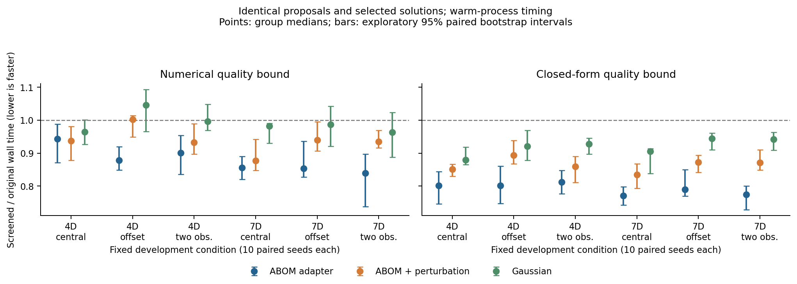
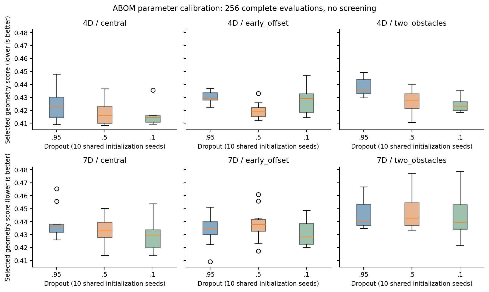

# ABOM评价预算改进与研究内容一的对齐

日期：2026-10-29。已完成参考轨迹剪枝、闭式下界、固定控制器场景剪枝先导和dropout校准；下文保留实验前设计与后续修订。本文由AI辅助完成材料核查、方法分析和实现；实验结果限于已链接的记录。

## 研究依据与边界

本轮以用户指定的《任务驱动的多无人机协同规划智能体方法研究-1023.docx》为准，重点读取2.2.1、2.3.2、2.7、2.8及第四部分。研究一的准确名称是“高敏捷无人机控制轨迹优化方法研究”：固定跟踪控制器，以机动时间、平滑性、实际跟踪误差及控制约束评价曲线，再用执行反馈改进在线候选搜索。原文件只读，未修改或复制到公开证据目录。

已有曲线主实验支持端状态保持参数化、统一几何评价和强基线比较，但不能支持真实跟踪性能结论。另一个已有五维生产规划器参数评价器确实运行固定控制器，但其对象是一阶速度/偏航滞后点质量，无旋翼、推力、风及感知模型，也不是新的四维Hermite轨迹跟踪接口。两个实验身份严格分开。[已有总结](当前工作总结.md)

原ABOM已有在线候选生成与精英学习，不能把这一循环本身作为新贡献。[ABOM §3](https://arxiv.org/html/2601.21475v2#S3)

已有研究亦覆盖解析/仿真/飞行多精度评价及可行性学习；TACO使用约束零空间修改样条并优化预测跟踪性能。因此“多曲线+神经网络”“多精度筛选”“保持端点的学习扰动”均不足以单独支持优先性主张。[Ryou等](https://arxiv.org/abs/2006.02513)、[Zhou等](https://arxiv.org/abs/2207.06176)、[TACO §IV-C](https://arxiv.org/html/2511.02060v1#S4.SS3)

## 本轮要回答的有限问题

在相同初始化、候选序列、种群规模、网络训练与最终解下，能否利用任务目标的下界减少完整评价，并实际降低计算时间？这是一项可复现的工程基线，不宣称下界剪枝是新优化理论。先建立这种确定性节省，才能判断以后增加控制反馈网络是否值得其成本。

设父代精英集合保留N个候选，其最差分数为tau，目标越小越好。若候选x的有效下界L(x)>=tau，则它不可能进入精英集合；相等时稳定排序保留原父代。必须比较最差精英，不能比较当前最优。初始种群全部评价；每代固定阈值。被剪枝候选的实际分数和可行性均为未知，不写成失败或成功。

### 实验A 参考轨迹评价

现有目标是可行时Q，不可行时1+失败检查占比+Q，其中Q由参考时长、jerk积分及形变RMS组成。因此便宜计算的Q是完整目标的下界。实现使用与原评价器相同的曲线次数和算术，并减去1e-10数值裕度；这不是区间算术证明。

计划：ABOM适配器、ABOM加扰动、高斯，4/7维空间，三个既有布局，新种子101至110，每次256个候选。原版与剪枝版交错顺序运行，逐候选核查参数、未剪枝分数、代际最优及最终参数一致。预算指候选数，完整评价次数另外统计。原版完整日志还用于独立核查每条剪枝下界；这些核查不计入部署计时。

### 实验B 固定控制器多场景评价

沿用既有五维参数、固定控制器与三个训练场景，每完成一个场景就计算完整目标下界。已完成的非负时间与平滑项除以总场景数，是最终平均量下界；若已出现失败，则最终必定落入不可行目标分支。其余未运行场景不能假定通过。只在下界已不可能进入精英集合时停止余下场景。

比较原版、固定顺序剪枝、按已有失败频率/评价时间调整场景顺序的剪枝。排序只影响先运行哪个场景，不能替代真实评价；它是受截断数据影响的启发式，不是校准概率。完整评价后按原场景顺序汇总，避免浮点求和顺序改变分数。

预设先导：三个搜索器，种子201至204，64个候选。每组所选参数仅在搜索结束后运行原有30个验证条件。主要统计完整场景调用、计算墙钟时间、CPU时间与解的一致性；机动时间单独报告。该小样本先导不能建立高敏捷实机性能或总体统计优势。

## 后续创新假设

更有研究价值的候选是：从每次执行中提取误差峰值所在区间、指令限幅区间与约束失败类型，学习哪些局部形状参数或时间参数值得调整，在有限在线样本下减少无效搜索。当前路径跟随器未提供同步参考RMSE与真实执行器饱和日志，不能补造这些标签。应先接通独立参考跟踪评价，再研究反馈条件化ABOM，并与标量反馈、简单反馈规则、强高斯/坐标搜索及相关可行性代理做消融。

指标应为同一跟踪误差、约束与质量标准下的规划耗时P50/P95、完整仿真次数、CPU时间及冷启动成本。参考执行时长缩短不等于规划计算变快。

## 实验结果

实验B第一批运行在静态审查时发现缓存口径不一致，主动中止；已完成记录保留并标记不用于耗时结论。修正版为两侧均缓存同一训练场景，种子改为301至303，另保存逐场景实际观察用于重放排序。小样本用于判断是否值得扩大，而非确认统计优势。

实验A后续消融预先规定：保持同样180组任务与种子，使用已推导的jerk闭式公式替换下界中的曲线构造和数值积分。默认端状态下，基线能量为720(8−T)²/T⁵，加上既有形变能量即可；RMS同样直接计算。先核查随机点与边界的数值一致性，再以交错的原版/闭式剪枝配对计时。不改目标、不改种群与网络训练；这一步检验筛选自身开销能否减少。

### 参考轨迹结果

两轮各180组原版/剪枝配对，每组256候选；使用同一180个“参数空间×布局×方法×种子”组合。闭式版是另一轮交错计时，不能把两轮当作360组独立任务。两轮均逐候选核对序列、每代最优和最终参数，全部一致；每轮46,080个剪枝版候选中，8,208个跳过完整评价。对应的真实分数来自配对原版，核验所有剪枝下界确实不超过该分数，且已超过当代最差精英阈值。[原始证据入口](../../experiments/abom_budget_20261029/README.md)

|搜索器|完整评价平均减少|数值下界：六组中位耗时减少范围|闭式下界：六组中位耗时减少范围|
|---|---:|---:|---:|
|ABOM适配器|24.92%|5.66%～16.00%|18.74%～22.96%|
|ABOM＋扰动|17.66%|−0.27%～12.33%|10.59%～16.50%|
|高斯|10.85%|−4.63%～3.69%|5.56%～12.05%|

负数表示变慢。每个组为一种空间和一个布局、10个种子；范围不是置信区间，分组探索性bootstrap区间保留在摘要JSON。闭式版与数值版的剪枝数量一致，额外收益来自更便宜的下界计算。它们减少评价工作，未改善相同候选序列得到的解质量，也不能据此称ABOM已超过高斯或坐标搜索。

这些是本机热进程的离线规划计时，包括网络初始化、生成、在线更新、下界和完整目标；排除了首次库/优化器加载、结果复核与写文件。一些任务耗时仍约一秒量级，未建立50Hz闭环部署、端到端延迟、内存或能耗收益。数学下界消元也是通用原则，本轮能主张的是具体任务实现与有界实验结果。

### 固定控制器负结果

修正缓存后的9组“三方法×三种子”对照，各含原版、固定场景顺序剪枝、自适应顺序剪枝；每次64候选。全部序列与最终解一致，选定的9组参数均通过各自原有30条件验证，共270次条件检查。三个训练场景的候选绝大多数通过，固定顺序总计仅跳过2个场景，自适应顺序没有减少场景数。ABOM固定顺序的场景数减少0.35%，其余为0；各方法中位耗时变化接近波动，不能主张稳定加速。此处记录的是现有到达/指令检查，不是同步参考RMSE或电机饱和。[控制先导](../../experiments/abom_budget_20261029/control_cached_pilot/summary.json)

因此暂不扩大“学习哪个失败场景先运行”的方案。可行样本占比极高时，仅依赖失败标签不足以有效分配预算。

### ABOM基线参数校准

固定种群16、256候选、原在线更新机制、关闭剪枝，以新种子401～410比较dropout 0.95、0.5、0.1，共180次搜索。三组共享初始化；执行顺序按六种排列交错，所有失败候选保留。四维空间中，降低dropout能改善部分条件的最终质量：中部布局0.1相对0.95的平均配对差约−0.00836；前移布局0.5约−0.01000；双障碍0.1约−0.01361。对应探索性区间不跨零。其他比较未必成立，七维没有统一改善，不能选一个参数后概括为普遍更优。[校准与配对区间](../../experiments/abom_budget_20261029/dropout_calibration/paired_comparisons.json)

这说明之前的0.95适配器不是充分校准的强基线；后续新增机制需同时对照经开发集选择的ABOM参数、强高斯及坐标搜索。调dropout本身不算论文创新，也不能在同一开发布局上调参后声称未见场景泛化。

## 当前判断和下一轮

当前最有证据的改进是“端状态保持参数空间上的解析下界辅助评价”，可以作为减少ABOM计算消耗的确定性基线。更贴近开题的控制反馈创新仍需补齐时序跟踪接口：现有生产路径跟随器的横向路径误差，不等于同一时刻参考跟踪误差。下一轮先建立独立标识的固定时序跟踪器，准确提取同步误差、误差位置和指令限幅诊断，再检验这些已有执行信息是否能减少搜索。其植物与控制律均须明确声明；先导结果不能冒称AirSim或真机验证。

共同初始化已含可行参考，首次可行解时间主要是在测初始参考的评价。后续主指标宜为固定计算时间下的解质量，或预先设定“严格优于初始参考”的质量目标到达时间；额外有限差分、诊断和网络训练均计入调用与耗时。

已准备独立的[`run_timed_tracking`](../../python/trajectory_research/timed_tracking.py)接口：固定速度前馈加位置反馈、速度与指令变化率限幅，一阶速度滞后植物用零阶保持指数闭式积分，输出完整状态、指令和同步误差诊断。它在T结束，保留默认非零终端速度，不追加悬停段；没有碰撞可行性输出，尚未接入ABOM目标。7项专项测试通过，覆盖恒速度、解析积分、非整除时长、两类限幅、终端速度及输入校验。

