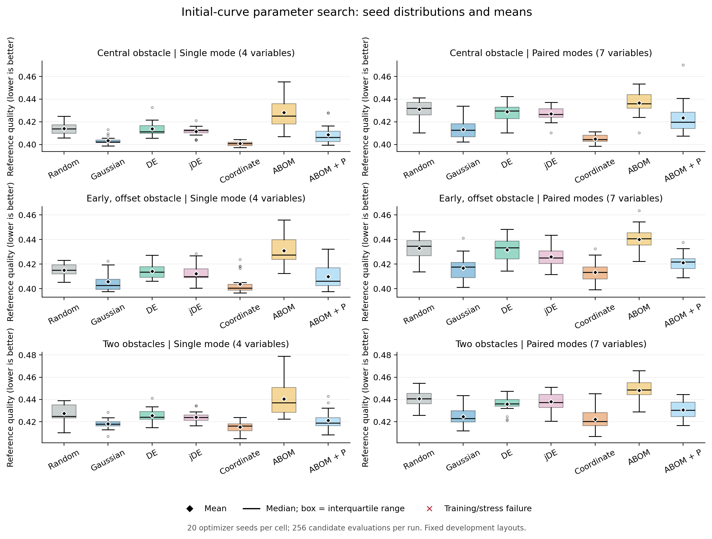
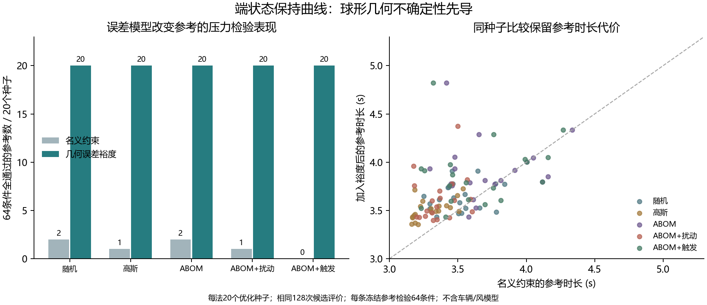
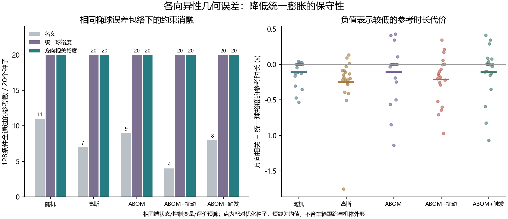

# Hermite、贝塞尔与扰动改进：当前工作总结

日期：2026-10-27。已完成前轮研究、本轮黑箱参数扰动主实验、新种子预算扩展和分阶段搜索。前轮与本轮的设置、计数和结论分别保留。

## 2026年10月29日计算预算更新

已按用户最新指定的1023版Word开题报告，将当前研究重点对齐“高敏捷无人机控制轨迹优化方法研究”。新增目标下界剪枝与闭式能量下界：在相同候选序列、网络更新和最终解下，ABOM的完整评价减少24.92%，六组参考轨迹条件的中位计算耗时减少18.74%～22.96%。这是热进程离线计算结果，不是轨迹执行时长或实机加速。高斯也受益，不能据此认定ABOM最强。[完整方法与边界](ABOM计算预算改进_20261029.md)、[可复核证据](../../experiments/abom_budget_20261029/README.md)

固定控制器的多场景提前终止先导基本无收益；修正缓存口径后的数据与被排除诊断均已保留。另完成180次dropout校准，部分四维条件支持低于0.95的设置，七维未见统一结论。后续机制须对照校准后的ABOM及强简单搜索器。

已新增[独立时序参考跟踪接口](../../python/trajectory_research/timed_tracking.py)，用于提取同步RMSE、误差峰值时间与指令限幅诊断；严格在参考区间结束。它是一阶点质量研究模型，尚未接入搜索目标与生产控制器。下文2026-10-27的实验、建议与限制作为历史记录保留，不与本轮计数合并。

## 继续改进的进展

已新增保持两端物理位置、速度、加速度的七次扰动：`b(u)[d+(u−0.5)e]`。Hermite中点状态与Bézier内部控制点使用同一参数域，500组随机换基核查的位置及前三阶导数差异小于约6×10⁻¹³；两者不作为不同曲线优劣排名。另已推导并核验两种形变模态的RMS与jerk能量。[实验设计](黑箱参数扰动实验设计.md)、[能量推导](七次扰动能量推导.md)

主实验比较随机、高斯、DE、jDE、局部坐标搜索、ABOM适配器和ABOM＋扰动，采用两种自由度空间、三个固定布局、20个优化器种子、每次256次评价，共840次运行、215,040次候选评价。全部840条冻结参考通过各自64个包络内压力条件，初始参考同样通过。改进体现在质量和参考时长，不能解读为通过率提升或飞行验证。[主实验摘要](../../experiments/hermite_perturbation_20261027/current/main/summary.md)

局部坐标搜索在主实验六个“空间×布局”组的平均质量均最低。中部障碍六次空间中，ABOM、ABOM＋扰动、高斯、坐标搜索的平均参考时长分别为3.8165、3.3422、3.2518、3.2084 s。七次空间增加了不对称自由度，但在相同预算下的均值较差。

新种子512次预算扩展完成300次运行：前两个布局坐标搜索质量均值最佳，双障碍则是高斯最佳，因此没有统一算法赢家。另完成90次“4→4、4→7、7→7”分阶段探索；低维起步均值较好，但4→7相对4→4的区间全部跨零，尚不能证明解锁切线有效。当前建议先优化少量端状态保持参数，保留高斯和坐标搜索强基线，再判断网络生成候选或更多自由度的额外价值。[完整结果与区间](黑箱曲线扰动结果.md)

本轮三组新实验共1,230次运行、391,680次候选评价、76,512个冻结压力条件；全部所选参考和初始参考通过包络内压力检查。训练中的不可行候选均保留。前轮的600次主运行、76,800次评价及退役组不混入本轮计数。

最终相关回归170项全部通过；主实验与扩展组的独立算术核查、分阶段专属链核查、三分包CRC及逐文件SHA检查均通过。新增初始曲线适配器可直接接收三维、次数不超过7的Bézier或Hermite曲线，相关7项接口测试通过；该通用接口尚未接入生产控制器。[测试记录](../../experiments/hermite_perturbation_20261027/current/final_tests.txt)、[接口用法](复现实验.md#把自己的初始曲线接入)



代码、图表和冻结证据发布至[GitHub研究分支](https://github.com/uuora/forAirsim/tree/codex/hermite-disturbance)。生产控制器与开始时已有的AirSim子模块修改保留。[公开证据入口](../../experiments/hermite_perturbation_20261027/README.md)、[重跑说明](复现实验.md)

## 当前建议

论文方法主线建议写为：**端状态保持的曲线形变与方向相关几何误差约束**。Hermite 用于端状态接口，贝塞尔用于连续区间的凸包检查，ABOM 作为可替换的候选搜索器。

前轮128次预算下，单独换曲线基或加入固定比例搜索噪声，没有获得足够的改进证据；本轮256次预算的结果见上节。前轮较有价值的结果来自明确建模几何误差，并减少统一安全膨胀的保守性。这里的误差球和椭球均为离线设定，尚未从真实感知残差标定。

## Hermite 与贝塞尔已区分清楚

同次数的两种表示可精确换基，不能据此声称谁天然更平滑或更抗扰。物理速度必须通过 \(m=Tv\) 转为归一化切向量。三次段固定两端位置和速度后，五次段固定两端位置、速度和加速度后，均没有剩余形状自由度。[数学与文献](文献与数学依据.md)

新增六次形变

\[
q(u)=p_H(u)+64u^3(1-u)^3d
\]

保持两端位置、速度和加速度，最大位移为 \(\|d\|\)，但端点 jerk 改变 \(\pm384d/T^3\)。已实现导数预算、贝塞尔升阶、节点接续、走廊和球障碍细分检查；无法认证的区间不判通过。[方法设计](方法设计与论文接入.md)、[代码](../../python/trajectory_research/curves.py)

100组随机边值检查的三次／五次位置换基误差分别不超过约 \(8.0\times10^{-15}\) m、\(5.9\times10^{-14}\) m。六次形变也通过端状态保持检查。[原始数值](../../experiments/hermite_perturbation_20261027/previous/geometry/geometry_results.json)

## 已完成的实验与结果

|研究层|设置|主要发现|
|---|---|---|
|现有控制器参数搜索|4种搜索器×5种子×128次评价；30个离线条件|全部所选参数通过回归，但固定比例扰动未优于原ABOM|
|曲线搜索消融|8种搜索策略×10种子×128次评价；8个几何压力条件|名义代价改善不保证新障碍条件可行；多数冻结参考存在失败|
|球形几何误差|5种搜索器×20种子×2种约束；每条参考64条件|名义6/100参考全通过，显式裕度100/100|
|椭球几何误差|5种搜索器×20种子×3种约束；每条参考128条件|名义39/100，统一裕度100/100，方向裕度100/100|

上表中的参考数由优化器种子产生。同一参考的64或128个条件是相关压力检验，不能当作独立飞行重复。所有失败均保留；本轮新增 AirSim 飞行和实机试验均为零。[完整证据核查](../../experiments/hermite_perturbation_20261027/previous/integrity_audit.md)

在现有五维贝塞尔控制器上，原ABOM与加入固定比例扰动后的平均验证运行时长分别为12.5043 s、12.5344 s。配对差值的探索性区间跨零，不能宣称新增扰动有效。该评价使用一阶速度与偏航滞后的点质量模型。[先导结果](../../experiments/hermite_perturbation_20261027/previous/search_pilot/summary.json)

球形误差实验将0.4 m名义半径加上0.30 m中心误差界和0.05 m半径增量，形成0.75 m等效半径，再保留0.1 m点参考净空。高斯搜索的平均参考时长由3.2991 s增至3.5097 s，代价与通过率改善一并报告。[名义组](../../experiments/hermite_perturbation_20261027/previous/uncertainty_nominal/summary.json)、[裕度组](../../experiments/hermite_perturbation_20261027/previous/uncertainty_margin/summary.json)



方向相关实验采用中心误差椭球 \(L=\operatorname{diag}(0.30,0.05,0.05)\) m，使用支持函数 \(\|L^\top n\|\) 约束每个细分段的分离方向。相同误差包络、端状态、变量和评价预算下，方向裕度相对统一裕度的结果如下：

|搜索器|统一裕度平均参考时长(s)|方向裕度平均参考时长(s)|均值变化|
|---|---:|---:|---:|
|随机|3.6788|3.5720|−2.91%|
|高斯|3.6603|3.4105|−6.82%|
|ABOM|3.9139|3.8024|−2.85%|
|ABOM＋扰动|3.7571|3.5437|−5.68%|
|ABOM＋触发|3.8715|3.7667|−2.71%|

两种裕度在这组压力测试中均无失败。不同搜索器的探索性配对区间并不都排除零，因此表格只报告当前均值，不能概括为所有搜索器均有确定收益。[配对分析](../../experiments/hermite_perturbation_20261027/previous/paired_profile_comparisons.json)



这些结果针对点参考与障碍的几何关系及参考时长，没有车辆动力学、跟踪误差、机体外形、风或感知模型。误差包络外的表现也没有保证。

## 已交付文件

- [第三章新增3.8节](../thesis/第三章_单机感知轨迹优化.md)：方法、负结果、误差裕度结果及与感知闭环的接续。
- [方法设计与论文接入](方法设计与论文接入.md)：公式、变量、创新边界和可直接使用的论文段落。
- [文献与数学依据](文献与数学依据.md)：核验来源、读取定位、已有工作与不能声称的结论。
- [六页可编辑补充PPT](Hermite与扰动规划补充说明.pptx)：曲线区别、形变、约束和球形误差实验；方向实验详见本总结。
- [研究代码目录](../../python/trajectory_research)：曲线、约束、搜索器、几何误差及方向证书。
- [逐条件结果CSV](figures/reference_results.csv)：仅供参考几何研究分析。

原 ABOM.pptx 已只读核查。其图片中的变异矩阵维度与原文正文有不一致，后续写作使用正文的 \(d\times d\)。材料核查保存在本地原始材料目录，用户演示文稿不随公开证据再分发。

## 核查与可复现性

最终相关回归为113项，全部通过。七组主实验共600个优化运行、76,800次训练候选评价；每次候选预算均为128。逐FE、共享初始化、最优解、边界、失败、选择与验证、摘要算术及源码快照已核查，未发现不一致。[核查结果](../../experiments/hermite_perturbation_20261027/previous/integrity_audit.json)

首轮 `search_pilot` 缺少部分后来增加的哈希字段，明确标为 `LEGACY_UNBOUND`，没有补造。另有100个早期椭球名义组训练运行，因冻结后发生数值实现修订而退出主统计；原12,800次评价保留，按最终源码重新运行，替代组名为 `ellipsoid_nominal_final`。含这一退役组，实际训练候选评价共89,600次。[退役记录](../../experiments/hermite_perturbation_20261027/previous/ellipsoid_nominal/EXCLUDED_FROM_MAIN_RESULTS.json)

前轮没有改动生产控制器与原有场景配置；开始时已有的AirSim子模块修改保留。研究成果统一在 `codex/hermite-disturbance` 分支整理发布。

重跑时应使用新输出目录，保留历史结果。例如：

```powershell
$env:PYTHONPATH='D:\forAirsim\python'
& 'D:\forAirsim\.venv\python.exe' python\run_curve_search_research.py train --profile ellipsoid_directional --methods random gaussian abom abom_perturb abom_triggered --seeds 50 51 52 53 54 55 56 57 58 59 60 61 62 63 64 65 66 67 68 69 --budget 128 --output reports\hermite_directional_reproduction
& 'D:\forAirsim\.venv\python.exe' python\run_curve_search_research.py validate --output reports\hermite_directional_reproduction
& 'D:\forAirsim\.venv\python.exe' python\run_curve_search_research.py summarize --output reports\hermite_directional_reproduction
```

ABOM组还依赖本地 `tmp/abom_deploy_probe/upstream/abom_net.py`，适配器核对其固定Git blob哈希。仅需无神经依赖的对照时，可把 `--methods` 改为 `random gaussian`，并使用独立输出目录。历史快照位于各实验的 `source_snapshot`，记录了对应原始源码字节。

## 下一步优先级

先用独立感知/定位残差标定误差球或椭球，并把机体尺寸与实测跟踪误差纳入净空；再将端状态保持解码器接入现有身份、来源时效和动作准入链，完成固定控制器下的跟踪和感知对照。随后补最接近轨迹规划方法的比较，判断真正的学术贡献。ABOM应保留强随机和高斯基线，当前结果不支持把网络搜索作为唯一核心。

AI辅助完成文献、推导、实现、分析和文字草拟。本文的实验证据限于所链接的本地记录。
