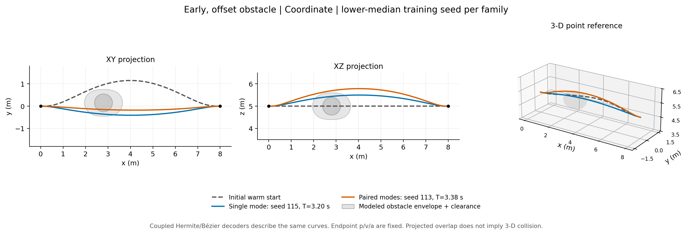
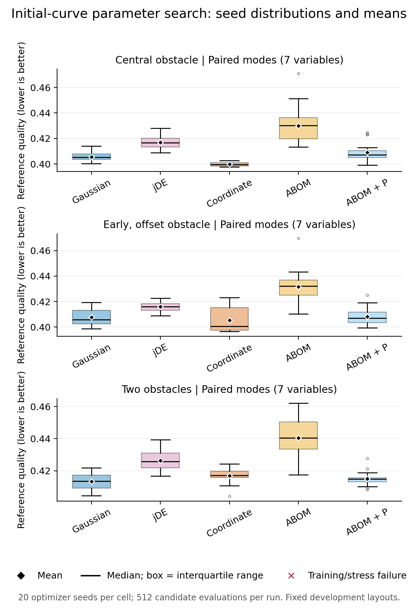

# 黑箱算法如何优化初始曲线参数

日期：2026-10-27。当前建议是：**先构造满足端状态的初始曲线，再在低维形变空间中使用黑箱搜索；把增加形状自由度与更换曲线表示分开验证。** 本文报告离线多项式点参考优化，参考时长不是实际飞行完成时间。[完整主结果](../../experiments/hermite_perturbation_20261027/current/main/summary.md)

## 1. 实际扰动的参数

基线是固定两端物理位置、速度和加速度的五次曲线，每次时长变化都重新构造。令

\[
b(u)=64u^3(1-u)^3,\qquad q(u)=p_H(u;T)+b(u)[d+(u-1/2)e].
\]

四维方案搜索 `[dx,dy,dz,T]`，固定 `e=0`；七维方案再搜索三个中点归一化切线增量。两项形变均保持端点的物理位置、速度和加速度。七次Bézier只需改变内部控制点：

\[
\Delta P_3=(64d-32e)/35,\quad\Delta P_4=(64d+32e)/35.
\]

因此Hermite和Bézier接口在同一参数盒中描述相同曲线，本轮不把它们当成两个不同算法。500组随机边界和候选的独立Bernstein差分导数检查，以及端状态核查均通过；这是有限数值覆盖，不是对全部浮点输入的形式证明。[解码器](../../python/trajectory_research/parameterizations.py)、[换基记录](../../experiments/hermite_perturbation_20261027/current/decoder_equivalence.json)

另已提供真正接收初始曲线的 `InitialCurveAdapter`：可从三维、次数不超过7的Bézier控制点或Hermite多项式提取端状态与当前形变，再由黑箱算法搜索增量。零增量重构初始曲线，时长变化仍保持物理端状态。它不依赖研究固定参数盒，调用者需定义增量边界和可行性目标；数值接口验证与本轮冻结优化实验分开记录。[适配接口及示例](复现实验.md#把自己的初始曲线接入)

形变代价使用实际曲线的RMS位移，完整jerk代价也按物理时间积分。对于同一时长的五次基线，形变能量满足

\[
\Delta E_J=\big[(147456/7)\|d\|^2+4096\|e\|^2\big]/T^5.
\]

精确分数核验给出两个模态的对角Gram矩阵；100组随机边界、两个解码器的200次完整能量对照也通过。端点jerk仍会改变，因此没有据此声称自动满足C3连续。[推导与可重放计算](七次扰动能量推导.md)

## 2. 黑箱搜索与公平对照

每个固定布局分别优化一条参考曲线。搜索器包括均匀随机、多精英高斯、DE、jDE、局部坐标轮询、固定上游ABOM网络的适配器，以及替换部分网络候选的ABOM＋成对扰动。DE使用冻结父代的一对一选择；jDE只让接受的候选继承控制参数。坐标轮询为本地启发式，不附带全局最优或MADS收敛结论。[实现](../../python/trajectory_research/blackbox.py)、[原始文献与参数依据](黑箱参数扰动实验设计.md)

同一“布局×空间×种子”下，各方法使用完全相同的16个初始候选；共同初始曲线的 `d=(0,1.15,0)` m、`e=0`、`T=5.5` s。每次优化严格256次评价，包含初始曲线及所有失败候选。三种布局、两种空间、七种方法、20个种子共840次运行、215,040次候选评价。[冻结设计及摘要](../../experiments/hermite_perturbation_20261027/current/main/summary.json)

约束包括连续区间内的凸工作空间、障碍净空和参考速度／加速度／jerk充分上界。中心误差椭球为 `diag(0.30,0.05,0.05)` m，半径增量0.05 m，点参考净空0.1 m。所有曲线统一以七次控制点检查，无法认证的候选视为不可行。误差包络是人为设置，尚未用感知残差标定。[任务定义](../../python/trajectory_research/perturbation_task.py)

跨四维和七维空间仅共享物理初始曲线和共同变量的边际参数域；由于维数不同，完整随机初代并不相同。因此跨空间结果反映“算法＋搜索空间”的联合表现，不是单纯改变表示的因果效应。

## 3. 256次预算的主要结果

下表为20个优化器种子的平均参考时长。实际优化的是同时含时长、完整jerk能量和RMS形变的共同质量分数；完整七方法质量表见原始摘要。

|曲线空间|布局|ABOM(s)|ABOM＋扰动(s)|高斯(s)|坐标轮询(s)|
|---|---|---:|---:|---:|---:|
|四维|中部障碍|3.8165|3.3422|3.2518|3.2084|
|四维|前移偏置障碍|3.8586|3.3763|3.2733|3.2443|
|四维|双障碍|3.9404|3.4952|3.4232|3.3786|
|七维|中部障碍|3.9531|3.5901|3.3793|3.2757|
|七维|前移偏置障碍|4.0051|3.5170|3.4424|3.4091|
|七维|双障碍|4.0711|3.6355|3.5188|3.5108|

坐标轮询在六个“空间×布局”组中的平均质量均最低。ABOM加入扰动后，在本轮256次设置下也优于其原适配器；但仍落后于高斯和坐标轮询。相关种子配对的探索性质量区间均保存在摘要，没有对多重比较校正。这一结果不能覆盖前轮128次预算及既有控制器先导中的负结果。[逐组及配对结果](../../experiments/hermite_perturbation_20261027/current/main/summary.json)

自由七次空间在21个“方法×布局”组合中的平均质量均高于四维空间；这不否定其可表达更多曲线，而是说明当前联合搜索未从增加参数中获得收益。均值方向不能代替全部配对区间：双障碍的原ABOM跨空间区间仍跨零。[同预算FE收敛](figures/parameter_perturbation/parameter_convergence.png)、[配对记录](../../experiments/hermite_perturbation_20261027/current/main/summary.json)

## 4. 可行性与证据范围

全部840条训练后冻结参考各通过64个包络内压力条件，合计53,760个条件；另6条共享初始参考共384个条件也通过，合计54,144。初始参考本来就可行，因此不能把这一结果写为通过率提升。训练中的90,468个不可行候选也完整保留，未从分母删除。[独立算术核查](../../experiments/hermite_perturbation_20261027/current/main/audit.md)

压力场景在所有训练选择冻结后生成，未用于重新选择参数。它们处于同一训练声明包络内，主要检查实现一致性；不是未见布局泛化，更不是独立飞行。图中XY投影与障碍重叠也不代表三维碰撞，应结合XZ和3D位置读取。

完整核查覆盖840个运行、逐FE与最优解、初始化、边界、训练/选择/验证哈希、独立jerk和RMS算术、压力包络、摘要及配对bootstrap。角色分工仍属于同一模型系列的AI审阅，不是独立人类专家；哈希也不证明日志的真实生成顺序。[核查JSON](../../experiments/hermite_perturbation_20261027/current/main/audit.json)、[阶段性算法回放](../../experiments/hermite_perturbation_20261027/current/method_review.md)

## 5. 新种子512次预算的确认与变化

扩展使用种子200–219，七维空间、相同三个布局和五种方法，每次512次评价，共300次运行、153,600次候选评价；303条含初始参考的19,392个包络内压力条件全部通过。新种子设置复现了ABOM＋扰动相对原适配器的改善，但并没有形成统一算法赢家。

|布局|ABOM(s)|ABOM＋扰动(s)|高斯(s)|坐标轮询(s)|质量均值最佳|
|---|---:|---:|---:|---:|---|
|中部障碍|3.8389|3.3272|3.2645|3.1870|坐标轮询|
|前移偏置障碍|3.8869|3.3227|3.2955|3.2729|坐标轮询|
|双障碍|3.9603|3.3698|3.3372|3.4048|高斯|

双障碍中高斯质量均值最低，ABOM＋扰动也低于坐标轮询。新种子的512次结果与主组256次结果不能直接当作同种子预算因果效应；另提供了同一512次运行的128／256／512训练前缀分析。前缀不作为独立样本，且没有把前缀选择冒充完整压力验证。[扩展摘要](../../experiments/hermite_perturbation_20261027/current/budget_extension/summary.json)、[扩展核查](../../experiments/hermite_perturbation_20261027/current/budget_extension/audit.md)

## 6. 先低维、再解锁切线的探索

进一步用新种子300–309比较三种总计256次评价的坐标搜索调度：四维128次后继续四维128次（4→4）、四维128次后解锁七维128次（4→7），以及两阶段七维搜索（7→7）。第二阶段重新初始化种群，并把前一阶段最优解放入首个评价槽；初始化和步长都重新启动。各阶段的初始评价全部计入预算。[实现](../../python/trajectory_research/staged_search.py)

90次运行共23,040次候选评价，含初始参考的2,976个压力条件全部通过。两种低维起步调度在三个布局中的质量均值都低于7→7，但4→7相对4→4的配对质量差异区间均跨零：

|布局|4→7 减 4→4 的平均质量差|探索性95%区间|
|---|---:|---|
|中部障碍|−0.0001845|[−0.001276, 0.001162]|
|前移偏置障碍|0.0003130|[−0.000982, 0.001685]|
|双障碍|0.0006906|[−0.001452, 0.002853]|

这项探索支持继续保留低维起步方案；它尚未证明解锁切线带来额外收益。跨4D/7D首代不同，调度同时涉及维数、重启和步长重置，不能归为纯单因素解锁效果。这里只使用专属的阶段链核查，没有把不适用的七维均匀初始化审计套用到嵌入式四维首代。[调度摘要](../../experiments/hermite_perturbation_20261027/current/staged_unlock/summary.md)、[配对比较](../../experiments/hermite_perturbation_20261027/current/staged_unlock/staged_comparisons.json)、[专属核查](../../experiments/hermite_perturbation_20261027/current/staged_unlock/staged_audit.json)

## 7. 论文与实现的当前选择

本轮三组新实验合计1,230次优化运行、391,680次候选评价、76,512个冻结压力条件，所有失败候选和不利结果保留。默认建议先优化三维中点位移与时长，用高斯和坐标轮询作强对照；七次模态作为可解锁选项，而不是默认宣传的收益。增加参数是否值得，应由等预算的完整代价、可行性和耗时共同决定。

将此接口用于论文闭环时，应把黑箱优化器接在既有身份、来源时效与动作准入之后，冻结控制器后重新检查跟踪与执行误差。当前点参考证书没有机体尺寸、推力、风或真实感知模型，不能直接据此替代飞行验证。

AI协助完成数学推导、实现、实验分析与写作。公开代码、原始记录清单和重跑命令见[证据入口](../../experiments/hermite_perturbation_20261027/README.md)、[复现实验](复现实验.md)。
