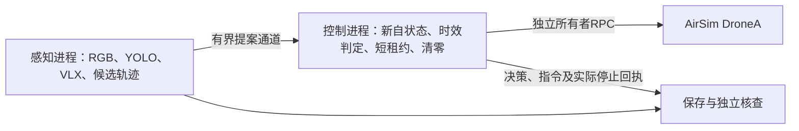

# 任务一控制进程隔离与100毫米接续计划

状态：计划，尚未实现或执行进程隔离飞行。2026年10月7日更新。

V10P2保存了更细的状态读取和派发证据。零门控通过；50毫米先导完成400帧且全部正确，但最后一次实际清零超源观测截止20毫秒，独立总核查未通过。下一查询启动晚到265毫秒，查询本身16毫秒；现有证据不能确定单一物理原因。[独立核查](D:/forAirsim/logs/t1_dispatch_50_analysis_v10p2_20261007/report.json) · [末尾时序](D:/forAirsim/logs/t1_dispatch_development_20261007/late_clear_diagnosis.json)

## 1. 下一步实现

将控制RPC客户端、当前自状态读取、目标时效判定、租约清零和严格停止置于单独的Windows spawn进程。感知、YOLO、VLX和媒体记录保持原算法与输入。父进程只提交不可变候选证书及期望XY速度，子进程使用实际新读取自状态重新判定。客户端、Future和含私密配置的对象不经进程通道传递。[当前线程控制实现](D:/forAirsim/python/t1_async_control_v1p7.py) · [当前派发实现](D:/forAirsim/python/t1_feedback_dispatch_v1.py)

设计目的为减少同一解释器内阻塞对控制查询的影响。进程隔离本身不证明时延改善；必须测量实际查询、派发和清零间隔。

## 2. 起飞前必需验证

| 项目 | 实现与验收要求 |
|---|---|
| RPC所有权 | 在子进程内创建客户端，所有调用及回调留在该所有者；启动、父进程收尾与控制进程的运动调用不能交叠 |
| 有界通信 | 提案、决策和回执均有容量上限；过载显式拒绝，不能复用旧提案、阻塞清零或静默丢证据 |
| 源与自状态时效 | 原源图0.5秒、自状态0.12秒保持；计时保留真实主机单调时刻，队列等待和跨进程复制计入源年龄 |
| 停止与实际清零 | 目标短租约0.12秒、原实际清零预留、严格停止速度/跨度/ distinct状态及原停止期限保持；分别记录名义租约与实际零指令 |
| 阻塞注入 | 分别阻塞父进程检测、媒体入队、记录序列化和结果读取；保存注入边界，核查子进程的实测响应 |
| 父进程失联 | 进程句柄/通道关闭和有界监测记录失联；子进程独立清零并核查停止。RPC失败保留未知，不以进程结束替代落地证明 |
| 关闭顺序 | 保留实际清零、采样停止、落地释放暂停和所属UE核查；未证实控制退出时不能让父进程并行发送落地指令 |
| 回执完整性 | 所有实际命令和拒绝可绑定源、状态、命令ID、派发时刻及对应停止；界面能显示失败和缺项 |

离线验证使用可控RPC替身与真实spawn子进程，先验证线程/进程ID、超时、通道溢出、失联和关闭。通过后另冻新源码、参数、版本和全部试次顺序。

## 3. 接续飞行与论文

新版本仍依次通过零门控、两次独立50毫米和100毫米；100毫米须800/800主槽完整并通过原端点和源截止核查。V10P2已冻结的重复和100毫米计划本轮未执行，旧失败与旧V10P1两次50毫米通过记录保留。[未放行回执](D:/forAirsim/logs/t1_dispatch_development_20261007/remaining_gates_not_admitted.json)

该控制门控通过后，继续完整姿态和三维轨迹执行，再冻结四方法配对场景与YOLO/VLX消融。第二章写清源时效、名义指令与实测执行判据；第三章分析保持正确身份仍可能发生控制时序失败的条件。双机与连续刷新任务继续沿原论文计划推进。[完整几何清单](D:/forAirsim/docs/research-plan-20261004/任务一完整几何执行与正式对照接续清单.md)

AI辅助实现规划和记录整理；作者审定方法及研究结论。
