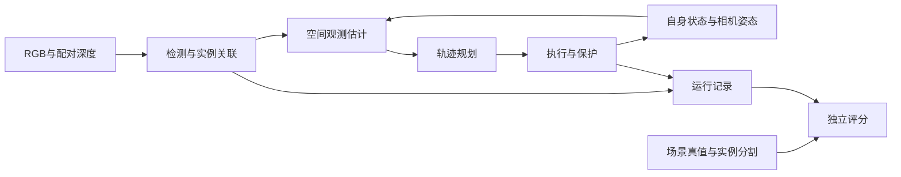

# 第二章 问题建模与仿真平台

正文草稿，证据复核更新于 2026-10-05；已有机载运行数据采集于 2026-10-04至05日。章节结构沿用[六章安排](D:/forAirsim/docs/research-plan-20261004/硕士论文章节任务与图表安排.md)。本稿定义公共接口并整理已经完成的开发测量；各研究方法的性能比较分别在后续研究章报告。

## 2.1 任务与系统组成

研究在 AirSim 中开展，任务对象为受控气球实例。单机任务要求一架无人机持续观测指定实例；双机任务研究两架无人机对同一实例的互补观测与角色交接；连续任务要求两机在有效接触后处理目标刷新，并重新观测、分配和规划。三个任务共享观测、运动执行和独立评价接口，研究范围保持为仿真。[任务定义](D:/forAirsim/docs/research-plan-20260930/AirSim三项研究执行路线.md)

系统由候选检测、指定实例关联、空间观测估计、轨迹规划和执行反馈组成。规划器接收图像推得的观测与无人机自身状态，输出带时间和版本的参考轨迹。场景设置及独立评分使用目标 actor 与分割信息；这些信息不进入在线候选选择。如此可以核对算法是否选择正确目标，同时保留视觉估计误差对规划的实际影响。[感知接口](D:/forAirsim/python/t1_semantic_perception.py)、[采集与评分分离实现](D:/forAirsim/python/t1_ground_perception_probe.py)

图2-1 表示公共数据流。独立评分读取保存的算法输出和真值，结果不会回写当次决策。

## 2.2 坐标、观测与时间模型

世界坐标采用 NED，三个轴分别指向北、东、下。车辆局部 NED 与世界 NED 的轴向一致，原点存在平移；相机坐标采用前向、右向、下向。设相机局部位置为 \(\mathbf c_L\)，经自身状态核验的原点平移为 \(\mathbf t_{WL}\)，相机至 NED 的旋转矩阵为 \(R_{WC}\)，则相机点转换为世界点的关系为

\[
\mathbf p_W=\mathbf c_L+\mathbf t_{WL}+R_{WC}\mathbf p_C.
\tag{2-1}
\]

旋转由按 \((x,y,z,w)\) 保存的相机四元数计算。原点平移与相机旋转分别处理，可以避免把车辆局部高度直接当作世界高度。[坐标实现](D:/forAirsim/python/t1_pose_geometry.py)、[AirSim坐标转换源码](D:/forAirsim/external/AirSim/Unreal/Plugins/AirSim/Source/NedTransform.cpp)

Scene 图像使用当前渲染投影给出的内参，主点约定为 \(c_x=W/2,c_y=H/2\)。对像素 \((u,v)\)，构造相机射线 \(\mathbf r=(1,(u-c_x)/f_x,(v-c_y)/f_y)^T\)。DepthPerspective 给出沿该射线的距离 \(d\)，因此回投点为 \(\mathbf p_C=d\mathbf r/\|\mathbf r\|\)。这一区分使图像边缘处的射线距离不会被误用为前向轴深度。[回投实现](D:/forAirsim/python/t1_pose_geometry.py)、[AirSim深度语义](D:/forAirsim/external/AirSim/docs/image_apis.md:225)

候选框内的有效深度用于选择一个实际像素的代表表面点。RGB 框中心视线再与该表面的轴向深度平面相交，作为居中参考。四个框角按同一深度平面回投，并使用实际相机姿态转至世界坐标，用于候选轨迹的投影评价。代表表面点、居中参考和 actor 几何中心具有不同语义；框内深度也可能来自背景，最终选取结果需要独立评分。[表面估计](D:/forAirsim/python/t1_candidate_surface.py)、[姿态投影](D:/forAirsim/python/t1_pose_geometry.py)

持续关联的空间接口进一步核对当前帧、描述、目标版本、完整候选内容和语义复核期限。只有处于跟踪状态且绑定一致的当前选择，才与该帧的 DepthPerspective 及其实际响应姿态配对。RGB 与深度的时间戳差和位姿差分别检查；相同内参仍是调用方声明的配对条件。候选框矩形在同深度平面上的回投提供可见支持区域，不能用于描述气球的完整三维形状。[持续选择表面接口](D:/forAirsim/python/t1_candidate_surface_v2.py)

每帧保存会话、目标版本、序号、图像哈希、回读接收时刻与处理完成时刻。主机单调时间用于计算 \(a_k=t_{\mathrm{dispatch}}-t_{\mathrm{readback}}\)，AirSim 时间戳另存。该年龄表示回读后的处理与等待，曝光至回读的时间没有包含在内。相机姿态和 RGB、深度响应分别核验，响应接近不等于精确曝光同步。[时间绑定](D:/forAirsim/python/t1_semantic_perception.py)、[实际相机回执](D:/forAirsim/logs/t1_pose_probe_validation_v1p1_20261004/summary.json)

逐帧语义复核版本另保存语义源帧至当前帧的完整候选链。源框先在原始源帧唯一匹配YOLO候选，每次更新核验序号连续、上下文与尺寸一致、唯一几何关联以及最多0.5秒的真实回读间隔。语义完成时刻、主线程轮询时刻与当前帧回读分别保留。开发配置将原始源年龄上限设为8秒，接受后仍需两帧真实更新图像确认，期限始终为原始源回读时刻加8秒；空间接口重新复算链证据并配对当前深度。传输配置10秒与源期限8秒分别控制请求和证据可用性，当前RGB年龄0.5秒、自状态0.12秒及短动作0.12秒保持原值。[逐帧链核验](D:/forAirsim/python/t1_delayed_semantic_bridge.py)、[当前表面核验](D:/forAirsim/python/t1_candidate_surface_v3.py)

## 2.3 轨迹、运动与安全约束

轨迹写为 \(\mathbf p(t)\)，其一至三阶导数分别为速度、加速度与 jerk。当前开发规划器按终点与持续时间枚举五次多项式候选，并在离散时刻检查工作区、运动幅值、目标距离、视场及显式障碍余量。候选排序回答的是给定有限集合中哪条可行轨迹代价最低。[规划实现](D:/forAirsim/python/perception_trajectory_planner.py)

执行器在实际发令时刻求取参考，结合保存的实际位置形成反馈速度。命令变化率使用真实请求间隔计算并设置间隔上限；实际速度和加速度由状态查询分别评价。当观测过期、空间边界不足或新候选不可行时，执行器保持、等待新观测或进入制动流程，并记录原因。[时序参考](D:/forAirsim/python/trajectory_timed_reference.py)、[执行保护](D:/forAirsim/python/trajectory_execution_guard.py)

身份接口采用短动作有效期，将一次当前帧选择限定为一次目标相关请求。发令前再次核对帧年龄、自状态接收时间和剩余有效期；失锁或时效不足时，目标相关请求被清除，随后依据自状态进入制动。AirSim 速度请求中的持续时间登记请求预算，实际停车通过显式清零和后续自状态采样核验。此前串行执行器在下一次阻塞采集、推理或媒体写入前完成这一停止流程。[动作准入](D:/forAirsim/python/t1_identity_motion_policy.py)、[串行停止流程](D:/forAirsim/python/t1_identity_flight.py)

独立控制版本将图像采集、YOLO检测、VLX回复轮询、空间估计、候选规划及写盘留在主线程，将研究段自状态查询、动作准入、速度请求和停止核验交给一个控制线程。低频网络调用由观察器的语义工作线程执行。主线程和控制线程各自创建并使用独立的 AirSim RPC 客户端及其异步请求对象；研究段只有控制线程可以发出运动请求。主线程提交当前帧、选择凭证、表面结果和期望速度的深拷贝。控制线程处理提交时重新查询自状态，再核对身份、时效、边界与实际发令截止时间；规划使用的状态快照不会代替这一发令检查。[客户端归属与提交](D:/forAirsim/python/t1_identity_flight_v2.py:341)、[独立动作准入](D:/forAirsim/python/t1_async_control.py:276)、[语义工作线程](D:/forAirsim/python/t1_delayed_semantic_observer.py)

控制线程按标称0.05秒查询周期和当前动作有效期截止时刻唤醒，到期后依据自状态发出制动请求，并记录首次显式清零。清零后的XY采样速度须不超过0.005 m/s，且连续合格查询的时间跨度达到0.05秒，才生成停止回执。待处理提案被覆盖时明确拒绝；当前动作尚未完成采样停止时，新提案也被拒绝，旧帧不能续期。控制记录先进入容量4096条的内存队列，由主线程统一写盘，溢出记为控制故障。[有效期与停止回执](D:/forAirsim/python/t1_async_control.py:230)、[提案处理](D:/forAirsim/python/t1_async_control.py:104)、[事件队列](D:/forAirsim/python/t1_identity_flight_v2.py:302)

时效分别记录观察器结果可用、控制决策返回、显式清零、采样停止和媒体处理完成。整帧完成取媒体处理与停止回执两者的较晚时刻；控制查询间隔和调度晚到另列。异步RPC回调记录返回真、返回假、其他结果或错误；任务被后续清零替换时可能返回假，回调状态与实际运动响应分别解释。Python线程、标称周期与RPC超时配置都需要实际回执评价，不能据其配置值推导硬实时或连续时间保护。[分离时钟](D:/forAirsim/python/t1_identity_flight_v2.py:485)、[请求结果回调](D:/forAirsim/python/t1_identity_flight_v2.py:121)、[调度回执](D:/forAirsim/python/t1_async_control.py:154)

低速制动候选采用等效窗口 \(h=1.0\,\mathrm{s}\)、模型参数 \(a=0.15\,\mathrm{m/s^2}\) 与额外位置余量 \(0.02\,\mathrm m\)。它已经在固定高度、XY 请求幅度 0.03 和 0.06 m/s 的两个新会话中核验，十六个会话内脉冲的采样停距均在声明余量内。该参数用于已测范围内的保护计算；更高速度、Z 方向和新的姿态条件需另行测量。[冻结输入](D:/forAirsim/configs/braking_response_v1p4/conditions.json)、[独立测量结果](D:/forAirsim/logs/braking_validation_v1p4_20261003/summary.json)

## 2.4 仿真与执行平台

平台以 Blocks 场景、DroneA 与 DroneB、RGB Scene 和 DepthPerspective 为公共基础。地面感知采集改变虚拟相机位置与朝向，车辆保持落地；飞行实验通过独立启动的 UE 进程运行。启动配置、源码、模型和媒体均与相应回执绑定，便于重算和区分版本。[气球采集归档](D:/forAirsim/logs/t1_balloon_adaptation_closeout_v1p2_20261004/receipt.json)

飞行生命周期与感知执行阶段分开记录。起飞和定高建立使用独立高度控制；低速研究段从姿态、高度和速度稳定后开始；落地阶段另存安全终态与控制释放证据。阶段内 XY 请求上限、实际运动峰值与起降运动分别汇总，避免把全程最高速度归入低速规划输出。新启动器在关闭仿真前重新检查两机的落地、自状态和 API 释放情况，并核对本次启动进程的路径、进程号及 UTC 启动时间。[新飞行生命周期](D:/forAirsim/python/t1_identity_flight.py)、[启动与安全结束](D:/forAirsim/scripts/run-t1-identity-flight-v1.ps1)

独立控制版本在研究段结束或异常退出时，先请求控制线程清零并完成采样停止，再等待线程退出；之后主线程使用自己的客户端接管落地与控制释放。若控制线程仍存活，运行记录保留故障，并保持仿真供后续恢复，防止两个客户端同时控制运动。落地与释放完成后再关闭观察器并序列化终态，避免模型请求或写盘延迟阻塞飞行收尾。[线程退出与生命周期交接](D:/forAirsim/python/t1_identity_flight_v2.py:475)、[控制线程收尾](D:/forAirsim/python/t1_async_control.py:318)

后续版本在起飞稳定及机载视图建立后，加入最多20秒、50个预定时隙的初始身份获取，期望XY速度保持零。当前身份进入跟踪且配对表面有效后，才开始原定零目标速度8秒或短XY可见、遮挡、返回7/2/7秒的主测量。获取帧、未使用获取槽和主测量槽分开归档，全局帧序号连续递增，漏采保留序号缺口；初始获取失败时，全部主测量槽保留为未进入。起始身份获取与遮挡后恢复因此使用独立时钟和分母。[获取与测量阶段](D:/forAirsim/python/t1_identity_flight_v3.py)、[属性检查版本执行](D:/forAirsim/python/t1_identity_flight_v4.py)

新机载首试显示，物理地面接触、解锁状态与 landed 标志的更新时间不同。首版因提前等待 landed 标志，未完成控制释放；补充恢复先检查地面接触和连续静止，再完成停桨与释放，随后等待 landed 标志。首次释放后查询仍出现瞬态不一致，第二份新回执确认两机落地、静止与控制释放，并安全关闭本次进程。原尝试和第一次恢复的失败状态均保留，结束状态通过不回填算法运行结果。[原尝试](D:/forAirsim/logs/t1_identity_flight_zero_v1_20261004/manifest.json)、[两次恢复](D:/forAirsim/logs/t1_identity_flight_zero_v1_20261004/supplemental_ground_recovery.json)、[最终恢复](D:/forAirsim/logs/t1_identity_flight_zero_v1_20261004/supplemental_ground_recovery_v2.json)

表2-1 汇总当前已有证据的配置。原固定高度配置与后续低速测量属于不同版本，后续研究章按各自实际采用的版本填写参数。

| 项目 | 配置与语义 | 依据 |
|---|---|---|
| 地面图像 | 640×480；Scene、DepthPerspective、Segmentation 配对保存 | [相机回执](D:/forAirsim/logs/t1_pose_probe_validation_v1p1_20261004/summary.json) |
| 固定高度开发 | 世界 Z=-3 m；XY 命令上限 0.15 m/s | [V6.2配置](D:/forAirsim/configs/trajectory_timed_pilot_v6p2/center.json) |
| 固定高度时效 | 最大回读年龄代理 0.50 s；实际经过时间参考 | [V6.2配置](D:/forAirsim/configs/trajectory_timed_pilot_v6p2/center.json) |
| 制动测量 | XY 幅度 0.03/0.06 m/s；固定高度；两个新会话 | [制动汇总](D:/forAirsim/logs/braking_validation_v1p4_20261003/summary.json) |
| 新机载集成先导 | 世界 Z=-3 m；XY请求限幅0.03 m/s；短请求预算0.12 s；标称图像周期0.4 s | [五轮独立分析](D:/forAirsim/logs/t1_identity_flight_analysis_final_20261005/report.json) |
| 模型环境 | Python 3.10.21、Ultralytics 8.4.153；训练用 RTX 3070 Laptop GPU | [训练回执](D:/forAirsim/logs/t1_balloon_yolo_training_v1p2_20261004/receipt.json) |

## 2.5 评价与实验记录

评价在事先登记的时间格上进行。设第 \(k\) 个区间长度为 \(\Delta t_k\)，有效输出指示为 \(o_k\)，输出身份正确指示为 \(i_k\)，目标真值可见指示为 \(v_k\)，定义

\[
R_{\mathrm{id}}=\frac{\sum_k\Delta t_k o_k i_k}{\sum_k\Delta t_k},\qquad
R_{\mathrm{obs}}=\frac{\sum_k\Delta t_k o_k i_k v_k}{\sum_k\Delta t_k}.
\tag{2-2}
\]

两项指标分别评价正确实例输出与有效可见观测。缺失算法输出保留为无输出；真值缺失或无法验证时报告覆盖率与上下界，完整指标留空。身份失锁和有效观测失锁分别计算连续时长及重获时间，超时与直到回合结束仍未恢复的情况保留。[评分核](D:/forAirsim/python/t1_identity_metrics.py)

连续地面开发进一步区分计划区间、实际图像回读及观察器完成时刻。123个保存帧对应124个预定区间，8个结果晚于所属区间、1个区间未采。保存帧上的身份匹配另列，晚到结果不倒填旧区间；6个回读超出区间导致该区间真值覆盖未知，完整比例留空。标称0.4 s采样在5/7/12 s阶段边界截短，实际阶段设置时刻另有记录。[采样定义](D:/forAirsim/python/t1_identity_schedule.py)、[独立时间格评价](D:/forAirsim/logs/t1_continuous_identity_analysis_v1p3_final_20261004/report.json)

独立统计以 UE 会话或登记回合为单位，相邻帧、请求和同会话脉冲保留为嵌套观测。成功率使用全部确认开始的回合为分母，失败、中断和缺终态均纳入；起飞前失败及起始未知单列。运行记录保存计划、开始、终态、原始观测、实际轨迹、命令、保护事件和图点。单元测试数量用于说明软件核验覆盖，图像数量用于说明观测规模，两者均不充当独立飞行样本数。[回合核](D:/forAirsim/python/t1_identity_metrics.py)、[全部开发尝试核对](D:/forAirsim/logs/braking_development_closeout_20261003/receipt.json)

运行器终态、独立身份资格和安全收尾分别报告。运行器曾以存在有效表面及非零动作判定集成通过，独立评分仍须核对所选实例及动作所依据的当前帧。语义源选错时，即使请求、图像哈希和逐帧链账本一致，也会形成错误目标动作，独立资格记为身份失败。恢复延迟要求遮挡前存在有效正确跟踪并观察到遮挡后的失锁；遮挡前已经丢失输出时，返回后的正确帧另列，恢复延迟保留不适用。[独立资格与恢复条件](D:/forAirsim/logs/t1_chain_analysis_final_v4p1_20261005/report.json)

## 2.6 公共接口验证与小结

公共验证包含几何一致性和实际执行两类证据。姿态感知几何已在一个地面 UE 会话的九种设置、十八帧上复算；固定高度 V6.2 开发批次保存十二次飞行、六个 UE 配对会话，完成目标请求与实际状态核验。低速响应另以两个新会话验证声明包络。[几何回执](D:/forAirsim/logs/t1_pose_probe_validation_v1p1_20261004/summary.json)、[固定高度台账](D:/forAirsim/logs/trajectory_matched_sweep_20261003_184327_9519224/sweep_report.json)、[制动回执](D:/forAirsim/logs/braking_validation_v1p4_20261003/summary.json)

持续选择表面回放使用已有四个地面会话的全部123帧，逐项核对369份 RGB、深度与分割媒体哈希。54个有身份输出的帧均形成配对表面，69个无身份输出帧保持无表面输出，另有1个预定时隙未采。代表深度像素和 RGB 居中参考的最大重投影差均为 \(2.8422\times10^{-14}\) 像素。该回环由同一投影模型正反计算，说明数值一致性；其值不表示相对于实测目标位置的空间误差。回放未新增仿真、飞行或模型请求，也不重新授予历史帧在线动作有效期。[全部帧表面回放](D:/forAirsim/logs/t1_temporal_surface_replay_20261004/summary.json)

新机载集成共保留五轮开发尝试，包括两次工程收尾失败、一次零目标速度门槛通过、一次时效准入失败及一次短XY运行通过。最终短XY先导在41个预定时隙中采集40帧，24个正确身份及配对表面支持24次非零目标请求，采样XY航程为0.02664米。请求速度最大0.01066 m/s与实际采样XY速度最大0.003526 m/s分别登记；起飞和落地没有进入这些统计。24次非零目标请求均找到显式清零指令，最晚清除时刻比短请求预算截止晚0.020秒，停止段保存查询最大间隔0.047秒。[五轮独立分析](D:/forAirsim/logs/t1_identity_flight_analysis_final_20261005/report.json)

短XY先导按观察器返回、动作门控决策和整帧完成分别统计时效。观察器晚返回11帧；实际动作门控决策29帧按时、11帧晚到，另有1个未采时隙。门控决定包含等待和动作准入，非零目标请求另外计数。包含动作执行与自状态停稳的整帧完成晚到24帧。阶段内保存自状态查询的最大间隙为0.5秒，0.05秒监测预算尚不能写成实测固定周期。现有证据支持固定高度下厘米级XY接口运行和采样停止核对，完整实时性与正式方法收益继续由后续实验评价。[时序与范围](D:/forAirsim/logs/t1_identity_flight_analysis_final_20261005/summary.md)

图2-2展示全部低速脉冲的保存查询速度，用于说明测量过程和幅度范围。它支持执行响应分析；连续时间峰值、精确作用延迟以及完整三维飞行仍需新的测量证据。

独立控制版本新增四个机载开发尝试，共预定122个时隙，保存103帧RGB，其中102帧同时保存深度与分割，1帧在处理异常中断后只有RGB。该帧身份未知，首轮余下17个未到达时隙与停顿试次的2个漏采时隙均保留。四轮运行终态均为失败，结束时均完成两机落地、控制释放、暂停与本次进程关闭；失败与安全收尾分别统计。[全部新增尝试及媒体核验](D:/forAirsim/logs/t1_async_identity_analysis_v2_20261005/report.json)

表2-2按执行日志中专用 `SELF_STATE` 查询回执计算相邻间隔。历史短XY版本最大间隔为328毫秒，P95为250毫秒；此前报告的0.5秒属于合并保存状态口径，且该历史阶段首个专用查询距阶段起点0.5秒，两种口径分别保留。三个完成计划时窗的独立控制试次最大查询间隔为78、94和78毫秒，P95均约63毫秒。它们全部处于无有效目标输出和零目标速度保持状态，与历史24次非零目标动作的负载不同。[独立时序复算](D:/forAirsim/logs/t1_async_timing_final_v2_20261005/report.json)

| 开发试次 | RGB实采/计划 | 专用查询最大间隔/P95（毫秒） | 非零目标请求 | 运行终态 |
|---|---:|---:|---:|---|
| 历史 short v1p3 | 40/41 | 328/250 | 24 | 通过 |
| async zero v2 | 3/20 | 63/63，至故障前 | 0 | 控制传输故障 |
| async zero v2p1 | 20/20 | 78/约63 | 0 | 无有效身份初始化输出 |
| async short v2p1 | 41/41 | 94/63 | 0 | 无有效身份及空间输出 |
| async delay v2p1 | 39/41 | 78/63 | 0 | 无有效身份及空间输出 |

两处主线程停顿实际持续0.656和0.657秒，内部保存15和14个专用自状态回执，跨越各停顿边界的查询最大间隔均为63毫秒；期间分别发出16和14次自状态零速度请求。停顿期间没有正在执行的非零目标动作，因此这些记录核验了感知阻塞期间的独立查询与保持，非零动作到期清除仍需联合闭环重测。图2-3展示实际回执间隔，各子图纵轴范围分别设置；首轮短记录终止于故障，不能据其查询最大值代表整个计划时窗。[停顿区间审计](D:/forAirsim/logs/t1_async_timing_final_v2_20261005/report.json)

逐帧语义链与源RGB属性检查进一步保存三次实际飞行，共119个完整RGB、深度和分割组。150个预定获取槽中实际采集19槽，剩余131槽明确记为获取成功后无需执行；主测量计划102槽、采集100槽，2个漏采保留。零运动V3和属性检查V4通过受控开发资格，短XY V3因6个错误身份帧及4个错误目标非零请求被独立判为身份失败，原运行器通过状态仍保留。三次均完成落地、释放、暂停、最新地面核验及自有进程关闭。另一次V3停顿尝试在UE启动时端口绑定失败，运行器未启动、飞行数为0，其自有进程清理单列。[全部帧、资格与关闭证据](D:/forAirsim/logs/t1_chain_analysis_final_v4p1_20261005/report.json)、[启动失败](D:/forAirsim/logs/t1_identity_chain_delay_v3_20261005/manifest.json)

属性检查V4主测量的15次非零目标请求均匹配正确实例，均保存显式清零，清除相对声明动作期限的最大晚到约21毫秒，最小观测截止余量167毫秒。获取及主测量合并控制时窗的专用查询最大间隔约78毫秒。两处主线程停顿实际各0.657秒，分别保存14和13个查询回执，触及停顿区间的最大查询间隔约63毫秒；两段均没有活动的非零目标动作。主测量实际采样XY航程为0.007531米，支持当前有限条件下的感知至动作接口核验，有研究意义运动尺度上的轨迹收益仍待测量。[执行、停顿及位移复算](D:/forAirsim/logs/t1_chain_analysis_final_v4p1_20261005/report.json)

三次飞行的16个语义请求均取得后端完成回执，最大耗时1.188秒，全部小于2秒。本轮运行没有覆盖真实超过2秒回复的飞行桥接，8秒原始源窗口的较长等待分支目前由受控Future测试验证。V4门控37个及时、2个晚到及2个漏采未知；整帧完成20个及时、19个晚到及2个未知，完整0.4秒周期仍未稳定。后续验证须分别覆盖慢语义回复、非零动作期间阻塞及实际运动尺度，保持这些时钟和分母定义。[真实请求与全部时隙](D:/forAirsim/logs/t1_chain_analysis_final_v4p1_20261005/report.json)、[延迟分支测试](D:/forAirsim/python/test_t1_delayed_semantic_bridge.py)

以上建模、坐标核验和分段执行测量为研究章提供统一观测语义、执行时钟和评分分母。最新接口已经连接逐帧语义证据、属性拒识及短动作，并完整保留语义选错、复核中断和处理晚到。正式轨迹比较继续核验有效感知与实际运动，任务一的四方法及消融仍待完成。[最新开发范围](D:/forAirsim/docs/research-plan-20261004/任务一逐帧语义复核与属性拒识结果.md)

### 后台交接、活动指令清零及事件口径

后台复核分别维护有效旧链与待确认新链；原源时间不变，采纳后两张实际新帧确认且选择相同当前候选才进行原子交接。失锁水印记录真实断链读回与观察时刻，新请求源及提交必须严格晚于这两个时刻。V5P1在失锁帧上提前拒绝提交，下一新帧仍通过原帧时效、上下文与传输槽检查。[交接实现](D:/forAirsim/python/t1_review_handoff.py)、[失锁感知提交策略](D:/forAirsim/python/t1_review_handoff_v1p1.py)。

新增V5与V5P1活动试次在已派发非零指令后实际阻塞主线程0.672/0.656秒，两次均保存15个自状态读回且在阻塞内显式清零。声明动作期限0.120秒，两次保存的显式清零均约0.125秒，差约5毫秒；期望期限、派发清零及物理响应因此分别评价。V5零目标速度试次查询最大间隔0.125秒，V5P1约0.110秒，不能由中位间隔推定每个查询都满足预算。[三次V5独立分析](D:/forAirsim/logs/t1_review_handoff_analysis_v5_20261005/report.json)、[V5P1独立复验](D:/forAirsim/logs/t1_review_handoff_analysis_v5p1_20261005/report.json)。

V5原活动试次的13条CHAIN_LOST诊断包括1次实际失锁和12次旧回复拒绝。事件计数、保存状态转移次数及持续失锁时长分列，V5P1对已无链的重复拒绝保留原水印。四次新飞行均保存独立终态及最新地面核验；V5原活动manifest的空路径字段保留，新V5P1启动器以新进程查询验证路径和UTC启动时间再写入。165组完整媒体与143个主测量槽的141个实际采集分别归档。[结果与原始证据](D:/forAirsim/docs/research-plan-20261004/任务一后台复核交接与中文图表结果.md)。

后续图表采用中文标题、坐标、图例与说明，并保存PNG/PDF、字体覆盖及原始图点映射；历史数据中文重绘另存为新图件。[图表规范](D:/forAirsim/docs/thesis/图表规范.md)。

### 2026-10-06 实际指令时钟与运动尺度验证

新的闲置策略只在真实零指令、两次以上满足停止判据的采样及当前自状态新鲜时省略重复清零，满0.30秒再实际刷新。变化率仍按上一实际派发回执计算，速度上限0.03米/秒、变化率0.15米/秒²、动作租约与自状态年龄0.12秒、当前图像年龄0.5秒保持冻结值。省略日志没有伪造指令回执。[控制器](D:/forAirsim/python/t1_async_control_v1p1.py)、[计划预检](D:/forAirsim/python/t1_motion_plan_contract_v1.py)。

四个独立UE运动会话沿用同一源码与预算，20秒主测量各保存50/50槽，共200帧指定实例复算正确，0错选；实际非零目标请求共199次，净位移依次为64.098、63.316、62.969、62.887毫米，全部达到预声明20毫米端点门槛。两个零输出会话各20/20槽、0非零目标指令、0毫米XY净漂移；旧V6起飞前校验失败另列零飞行。[全部独立分析](D:/forAirsim/logs/t1_motion_scale_analysis_v6p1_20261006/report.json)。

4个运动会话动作门控与观察器各200次按时，包含执行和采样停止的整帧完成198/200次晚于原槽截止；固定0.4秒整流程仍未通过。采样停止阈值为5毫米/秒，本组实际XY速度峰值约3.6–3.7毫米/秒；已知目标指令派发至清零区间之外，采样位移向量模长约44毫米；跨边界样本另列，该分类不是独立无输入漂移实验。清零与物理静止分列。端点均使用主段起始自状态至20秒采样结束后0.5秒尾段的显式终态，回执跨度20.5秒，起降排除。[全部独立分析](D:/forAirsim/logs/t1_motion_scale_analysis_v6p1_20261006/report.json)。

主段图像时间格和端点状态跨度分别保存。主机时钟可能对连续操作返回相同数值，本组复核使用同一控制生产者的日志顺序区分先闲置后派发；精细物理时刻未知。[本轮结果与下一步](D:/forAirsim/docs/research-plan-20261004/任务一运动尺度重复验证与论文更新.md)。

### 2026-10-07 V6P1分支时钟与清零后残余运动口径

已有V6P1日志的离线复核将主线程帧处理与独立控制停止分列，整帧完成仍取两者最大值，与原0.4秒槽截止比较。`frame_results.jsonl`在帧处理结束时追加，尚无最终停止回执，不能用其中的决策完成时间替代最终报告的整帧结束；本次逐帧比较追加日志与封存报告的采集、门控、指令和帧处理字段，并保留两种时钟。运动4会话的200个帧处理均按时，停止回执决定200个最终完成时间；198个晚到中55个在实际清零时已晚到，143个在清零至停止回执段越界。[逐帧时序与原日志绑定](D:/forAirsim/logs/t1_v6p1_late_residual_analysis_final_20261007/frame_stages.csv)

残余窗口从非零目标指令对应的实际清零事件起，到下一条实际非零指令或原主段显式终态止。只累加严格在窗内的相邻自状态位置差，边界样本和同主机时间对应不同XY位置的线段单列未分配；不插值清零位置。重复零指令仍可能在窗内派发，因此不是无输入漂移实验。停止回执后的运动是清零后运动的子集；原5毫米/秒阈值与0.05秒合格样本跨度定义采样停止，不能推出物理速度为零。会话级指标与帧/指令/状态线段分别保存，独立运动重复数为4。[窗口与覆盖缺口](D:/forAirsim/logs/t1_v6p1_late_residual_analysis_final_20261007/post_clear_windows.csv)、[中文口径说明](D:/forAirsim/docs/research-plan-20261004/任务一V6P1整帧晚到定位与清零后残余运动.md)

### 2026-10-06 严格采样停稳与实际清零预算

反馈制动以清零时无人机自身XY位置为参考，按自身速度及位置误差生成期望速度，再施加边界、速度和按真实前一指令时间计算的变化率限制。反馈期望速度上限0.015米/秒，实际指令仍受0.03米/秒全局上限约束。采样停稳要求XY速度不超过0.5毫米/秒、连续稳定至少0.10秒、清零后观察至少0.30秒、至少三个不同仿真状态时刻，且自身参考位置误差不超过2毫米。目标指令和清零后的自身状态反馈分别记账，反馈不续期目标图像或VLX源证据。

目标派发为实际清零预留0.12秒，但保留原观测截止点。令原观测截止点为当前RGB读回时间加0.5秒与复核截止点中的较早值，再扣除原0.02秒新鲜度余量；新版本将声明租约结束限制在这个原截止点之前0.12秒。剩余预算不足0.01秒时撤销该目标动作。这一策略缩短或拒绝动作，实际清零是否及时仍由日志核查。

帧处理和控制停稳分别评价。原完整完成时间继续取两者最大值，仍与原0.4秒截止点比较。最新两次60秒运动共有30/300个帧处理晚到，原完整完成晚到172/300；分开计时不能将这些晚到改标为及时。控制停稳另与从声明租约结束起2秒的预先声明时限比较。 [逐帧、指令及自身状态独立分析](D:/forAirsim/logs/t1_strict_settlement_analysis_final_20261006/report.json)

两次V7P3独立UE会话均在冻结的60秒条件下达到20毫米门槛，净位移分别为22.972、23.468毫米。共保存300/300个主测量帧，独立评分300个正确、0个无输出、0个错选；实际非零目标派发145次，严格停稳、实际清零时效及派发预算均经独立核查。 [逐帧、指令及自身状态独立分析](D:/forAirsim/logs/t1_strict_settlement_analysis_final_20261006/report.json)

### 2026-10-06 源证据扰动与时钟分离

真实后端完成回执共80个，其中自然耗时超过2秒的回执0个。人工延迟交付另计4次，预先声明的等待为3秒与9秒，均作用于真实VLX返回结果。原图像来源、原回复时刻和结果内容保持，人工等待时刻单列；自然服务耗时和人工等待分别评价。 [逐帧、媒体、源链与控制独立分析](D:/forAirsim/logs/t1_source_fault_analysis_final_v8_20261006/report.json)

后台等待由唯一复核线程执行，不占用前台采图或独立控制线程。源RGB、真实回复时刻与后来交付时刻分别保留，过期证据的拒绝按原链期限检查。遮挡物和干扰材料只用于场景执行，真实分割只用于独立评价。

### 2026-10-07 预声明尺度与证据回放

本轮160/320秒条件与50/100毫米判据均在飞行前声明。指令速度上限、租约、源图时效、实际清零预留和严格采样停稳保持原值。不同阶段时长形成不同执行尺度条件；位移增大不能解释为某方法更优。帧具有时间关联，试次是独立单位。固定高度XY仍未建立完整几何轨迹优化，原0.4秒完整完成晚到保持原判断。 [完整审计与中断记录](D:/forAirsim/logs/t1_scaled_campaign_analysis_v9_20261007/report.json)

Qt5回放使用分析、原报告和RGB校验值绑定来源，初始化与主帧分别记账。失败未采集槽位保留，缺少实际时钟时显示计划时刻；中断流水明确未评分。缺少终态的试次没有已核实端点，单图云端请求仍为图像＋文字。[界面与核查说明](D:/forAirsim/docs/任务一Qt5实验工作台.md)

### 2026-10-07 主线程检查点与独立停止时钟

采样成本从采集开始到帧处理结束分成九个首尾相接的主线程区间；独立控制停止尾段可能与后帧重叠，单列。观察器区间含检测、属性判断、语义轮询和关联，表面结束至控制提交含自状态取得、规划和提交；已有区间不能解释为单一算法的纯CPU耗时。未来即使证据落盘改为队列，入队也不能代替媒体及评估记录实际完成。整帧完成仍取帧处理和停止的较晚时刻，与原400毫秒截止点比较。[采样成本与下一轮修复计划](D:/forAirsim/docs/research-plan-20261004/任务一采样成本定位与下一轮修复计划.md)

### AI协助说明

本稿的结构、措辞和公式整理由 AI 辅助；定义对应项目实现，测量值对应链接中的原始回执。最终学位论文的引用编号、学校格式和实测研究结论在全文汇总时统一校核。

### 2026-10-07 实际文件完成与有界流水

新增最多3帧的媒体在途队列、4096容量的控制事件队列和实际刷新回执。RGB在检测前保存并校验；深度、分割真值评分及不可变逐帧记录在动作判定后异步保存。完整完成仍取实际帧处理和独立控制停止的较晚时刻，原400毫秒晚到保留。后台记录既不建立运动权限，也不刷新源图时钟。[原声明](D:/forAirsim/docs/research-plan-20261004/任务一有界记录流水验证方案.md)

首个V10零门控在初始化控制证明中失败；严格证明检测到当前状态与窗口末尾不匹配。V10P1明确拒绝不可用证明并保持零动作，等待新状态，不放宽阈值。首个V10P1运动会话在起飞前设置纹理失败，另开相同冻结条件重试；失败均单独记账。[补充验证声明](D:/forAirsim/docs/research-plan-20261004/任务一有界记录流水补充验证方案.md)

[组件统计与逐帧时钟](D:/forAirsim/logs/t1_bounded_sampling_analysis_20261007/report.json)

### 2026-10-07 本地派发时效和实际源截止

自状态查询、校验、条件锁、事件入队、反馈准备及本地派发截止分别记录。过期反馈先拒绝并实际清零，再最多读取一次新状态重算；原源图0.5秒、自状态0.12秒、目标租约0.12秒及停止期限保持。名义租约结束和实际清零是不同的执行时刻：本批最后一帧本地派发反馈新鲜，但下一查询晚到使目标实际清零超源截止20毫秒，总核查失败。[反馈时效改进与末尾清零复验结果](D:/forAirsim/docs/research-plan-20261004/任务一反馈时效改进与末尾清零复验结果.md)

### 2026-10-08 独立控制进程与采集中断复验

V11已实飞三次：零门控20/20通过；50毫米先导400/400完成、380正确/20无输出、净XY位移58.676毫米，通过独立开发核查；独立重复389/400完成、390已开始，因配对采集中断未通过，端点未知，100毫米未放行。三次停止、落地、释放、暂停与所属UE关闭已核实。 [本轮结果与证据](D:/forAirsim/docs/research-plan-20261004/任务一控制进程与采集中断复验结果.md)

重复中首次目标清零提前原截止184毫秒；原晚到提示来自旧收尾回执覆盖首次清零时钟。补充核查保留原报告和未通过判定。新采集诊断与首次清零修正各组12项测试通过，尚未集成实飞。Qt回放全部16次尝试、显示未知输出和两种时钟，20项界面测试与10张PNG检查通过，原生桌面交互未验收。 [Qt5指南](D:/forAirsim/docs/任务一Qt5实验工作台.md) · [下一轮接续](D:/forAirsim/docs/research-plan-20261004/任务一V11P1采集与首次清零接续计划.md)

当前仍是固定高度XY工程验证；正式三维执行、四方法对照及YOLO/VLX消融待完成。旧失败、无输出与212帧未评分流水继续保留。AI辅助实现和整理，解释以保存证据为准。
