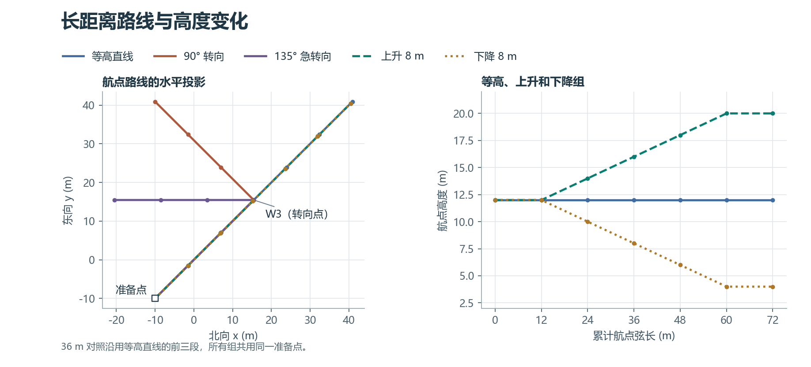
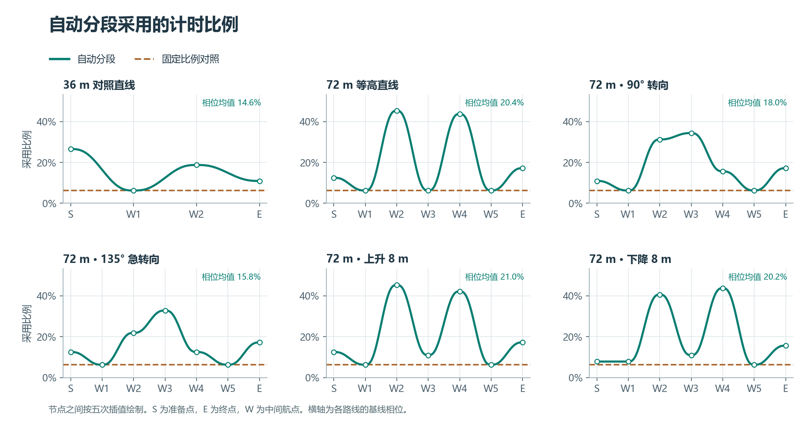

# TOPPQuad 长距离分段计时实验

2026-11-22 在 AirSim Blocks 的同一 GenericQuadX／SimpleFlight 配置下执行 18 个预定组合，通过 18/18，确认安全落地 18/18。5 条长路线各约 72 m，分段组通过 5/5。飞行用时从开始跟踪计至满足终端条件，规划墙钟从准备点提交任务计至主进程收到规划结果。[逐架遥测复算](flights.csv) · [源数据和预检候选记录](telemetry.zip)

## 路线设计

所有组合使用 Hermite 曲线，按路线对照普通基线、固定比例 TOPPQuad、自动分段 TOPPQuad。每个组合飞一次，每架次从新开的仿真实例起飞。准备点为 (-10, -10, 12) m，各长路线为六段、每段三维弦长约 12 m。36 m 对照与长直线共用前三段，在 W3 停稳。90° 和 135° 表示 W3 前后相邻航段的行进方向夹角。爬升与下降的四段坡度分别约 +9.59° 和 −9.59°，首尾各一段等高。同一路线的三架次条件指纹一致，两个 TOPPQuad 对照的原始 $h_{\rm raw}$ 数组逐值相同。全部路线使用同一张 Blocks 地图、同一组动力与控制参数。[航点坐标](../../configs/long_distance_routes.json) · [调度顺序](../../python/run_long_distance_experiment.py) · [遥测归档](telemetry.zip)



实测验收为全程同步位置误差峰值 ≤ 0.30 m，计划过点时的实测距离 ≤ 0.30 m 且实速 ≥ 0.50 m/s，终点位置 ≤ 0.25 m 且实速 ≤ 0.50 m/s。指令模长上限 6 m/s，指令变化率上限 6 m/s²。两种 TOPPQuad 共用带滞后、延迟的模型预检及名义指令余量，固定对照按 25%、12.5%、6.25%、3.125% 的顺序采用首个通过档位。逐架独立核对状态、指令、准备点前后事件和落地回执。[共同配置](../../configs/fast_route.json) · [独立审核](../../python/flight_comparison.py)

## 各组实测结果

| 路线 | 普通基线 (s) | 固定比例／用时 (s) | 自动分段 (s) | 比固定节省 (s) | 分段峰值误差 (m) | 分段实测峰速 (m/s) |
|---|---:|---:|---:|---:|---:|---:|
| 36 m 对照直线 | 16.815 | 6.25% / 14.931 | 13.899 | 1.032 | 0.2246 | 4.120 |
| 72 m 等高直线 | 33.613 | 6.25% / 29.047 | 24.874 | 4.173 | 0.1881 | 4.116 |
| 72 m · 90° 转向 | 33.616 | 6.25% / 30.694 | 28.018 | 2.676 | 0.2112 | 4.063 |
| 72 m · 135° 转向 | 33.610 | 6.25% / 30.889 | 28.936 | 1.953 | 0.2365 | 4.041 |
| 72 m · 上坡 8 m | 33.613 | 6.25% / 28.936 | 24.430 | 4.506 | 0.1940 | 4.162 |
| 72 m · 下坡 8 m | 33.607 | 6.25% / 29.485 | 25.126 | 4.359 | 0.2013 | 4.142 |

72 m 组的分段方案在五组配对里都提前到达，相比固定 6.25% 少用 1.95–4.51 s（6.32%–15.57%）。五次分段飞行的中间点实测速度为 1.333–3.991 m/s，机体实测峰速为 4.041–4.162 m/s。每个组合只有一架次，结果适用于这批预设和共同跟踪器。[逐架用时、峰值误差和失败字段](flights.csv) · [逐航点实测速度与距离](waypoints.csv)

## 自动分段采用了多少原始计时改变量

| 路线 | 相位平均系数 | 最高节点系数 | 按原始改变量幅值加权的采用比例 | 起点 → 中间点 → 终点 |
|---|---:|---:|---:|---|
| 36 m 对照直线 | 14.58% | 26.56% | 12.76% | 26.56% → 6.25% → 18.75% → 10.94% |
| 72 m 等高直线 | 20.44% | 45.31% | 23.86% | 12.50% → 6.25% → 45.31% → 6.25% → 43.75% → 6.25% → 17.19% |
| 72 m · 90° 转向 | 17.97% | 34.38% | 13.75% | 10.94% → 6.25% → 31.25% → 34.38% → 15.62% → 6.25% → 17.19% |
| 72 m · 135° 转向 | 15.76% | 32.81% | 11.43% | 12.50% → 6.25% → 21.88% → 32.81% → 12.50% → 6.25% → 17.19% |
| 72 m · 上坡 8 m | 20.96% | 45.31% | 24.62% | 12.50% → 6.25% → 45.31% → 10.94% → 42.19% → 6.25% → 17.19% |
| 72 m · 下坡 8 m | 20.18% | 43.75% | 23.18% | 7.81% → 7.81% → 40.62% → 10.94% → 43.75% → 6.25% → 15.62% |

匹配的 36 m 与 72 m 直线中，相位平均系数为 14.58% 和 20.44%，幅值加权采用比例为 12.76% 和 23.86%。两种任务都使用 100 个原始求解节点。延长这条直线增加了相同段长的连续过点航段，影响范围包括中间点数量和求解网格的每米密度。[各段相位和用时](leg_timing.csv)

同为 72 m 的三条等高路线中，平均系数随转角增大从 20.44% 降至 17.97% 和 15.76%。135° 组加权采用比例为 11.43%，低于 36 m 直线的 12.76%。上坡和下坡组的平均系数为 20.96% 和 20.18%。这批数据支持在有充足直线或坡段的长路线采用更多原始计时改变量，急转弯组采用的份额较少。[各组计时数据](flights.csv)



## 计时改变量的含义和作用

普通基线给出几何曲线 $p(s)$，其中 $s$ 是基线参考时间对应的路径相位。用 $h(s)=(ds/dt)^2$ 表示进度速率的平方。基线的 $h=1$，原始 TOPPQuad 在同一路径上给出 $h_{\mathrm{raw}}(s)$。执行参考使用

$
h(s)=1+\alpha(s)\bigl(h_{\mathrm{raw}}(s)-1\bigr),\qquad 0\le\alpha(s)\le1 .
$

计时改变量是 $h_{\mathrm{raw}}-1$，计时比例 $\alpha$ 是其中被采用的份额。0% 对应基线计时，100% 对应原始 TOPPQuad 计时。举例来说，若某处 $h_{\mathrm{raw}}=4$，采用 25% 后 $h=1.75$，该处的参考速度约为基线的 $\sqrt{1.75}=1.323$ 倍。原始解满足 $h_{\mathrm{raw}}<1$ 的位置会随采用比例提高而减速。全程用时由 $T=\int ds/\sqrt{h(s)}$ 给出。

自动分段为起点、各中间点和终点分别选系数，在航段内用五次插值平滑过渡。参考速度为 $p'(s)\sqrt{h}$，参考加速度为 $p''(s)h+\tfrac12 p'(s)h'$，因此调速比例及其沿路变化都会影响跟踪器的速度指令和制动余量。搜索用已有的预测跟踪、名义指令余量和推力预检，在评估过且可行的候选中选参考时长最短者。准备点规划完成后冻结参考。[时间映射与搜索代码](../../python/segment_retiming.py) · [参考导出](../../python/route_timing.py)

报告同时给出相位平均系数 $\bar\alpha=\int\alpha(s)ds/\int ds$ 和按原始改变量幅值加权的采用比例 $\int\alpha(s)|h_{\mathrm{raw}}(s)-1|ds/\int|h_{\mathrm{raw}}(s)-1|ds$。前者刻画整条路的系数水平，后者把原始解实际调整较多的位置赋予更大权重。两者都按基线路径相位计量。飞行用时和实测峰速由 AirSim 遥测单独计算。[逐段数据](leg_timing.csv)

同一 W3 在等高直线和转向路线上的计时可以直接对照。原始解在转向点给出的进度速率较低，采用比例较高时仍可得到较低的过点速度。

| 72 m 路线 | W3 原始进度平方 | W3 采用比例 | 参考过点速度 (m/s) | 实测过点速度 (m/s) |
|---|---:|---:|---:|---:|
| 72 m 等高直线 | 20.153 | 6.25% | 1.779 | 1.623 |
| 72 m · 90° 转向 | 2.297 | 34.38% | 1.443 | 1.368 |
| 72 m · 135° 转向 | 1.879 | 32.81% | 1.362 | 1.424 |

## 规划耗时及学习加速方向

| 路线 | 原始 TOPPQuad 阶段 (s) | 分段搜索与预检 (s) | 完整规划墙钟 (s) | 候选数 |
|---|---:|---:|---:|---:|
| 36 m 对照直线 | 38.39 | 8.15 | 46.65 | 47 |
| 72 m 等高直线 | 28.09 | 16.86 | 45.05 | 83 |
| 72 m · 90° 转向 | 39.03 | 18.40 | 57.53 | 82 |
| 72 m · 135° 转向 | 41.78 | 17.64 | 59.52 | 81 |
| 72 m · 上坡 8 m | 30.60 | 16.64 | 47.36 | 83 |
| 72 m · 下坡 8 m | 30.38 | 18.88 | 49.42 | 83 |

长路线中通过的自动分段组，原始求解和分段搜索的墙钟中位数分别为 30.60 s 和 17.64 s。原始求解阶段包含装载及构建优化问题，逐架另有 IPOPT 时间。[分段计时原始记录](flights.csv)

1. **用 LSTM 编码器－解码器给原始 TOPPQuad 热启动。** 将路径的相位采样、曲率、坡度、离终点距离和速度／动力约束编码成序列，监督学习输出正值的 `h_raw` 初值，仍由现有非线性求解器求可行解。按完整路线与路线家族切分训练、验证和测试，用相同 IPOPT 容差比较冷启动、相似路线解和学习初值，记录迭代数、完整墙钟及回退次数。Mao 等的 CoRL 工作使用序列模型预测平方速度与偏航曲线，表 3 的仿真对比中 TOPPQuad 与 LSTM 平均计算时间为 10.083 s 和 0.069 s。该结果使用其路径和硬件设置。[CoRL 论文](https://proceedings.mlr.press/v305/mao25b.html) · [表 3 和计时定义](https://arxiv.org/html/2506.13915v1)
2. **用 LightGBM 给分段比例候选排序。** 输入每段长度、曲率、坡度、原始解的速率及制动余量，输出候选的可行性和预计参考用时。用冻结的完整候选和预检回执监督训练，在线先验算排名靠前的几条，并保留固定候选与现有搜索作为回退。这个阶段瞄准多次导出与全路线预检的开销。[LightGBM 方法论文](https://proceedings.neurips.cc/paper/2017/hash/6449f44a102fde848669bdd9eb6b76fa-Abstract.html)

应用验证应按完整路线留出测试集，覆盖更长直线、反向转弯和组合升降，记录含推理、验证和回退的准备点规划时间中位数及 P95。同时复测原有 0.30 m 和 0.50 m 过点门槛、终端和用时。现有实测是确定性规划基准，候选数据可用于建立下一阶段的监督数据集。

## 复跑和独立复算

在项目根目录运行批量入口可重新生成飞行记录。复算可直接使用压缩包，按路线输出六份审计页。

```powershell
.\.venv\python.exe python/run_long_distance_experiment.py --airsim
$outputDir = 'reports/long_distance_audit_local'
Expand-Archive -LiteralPath 'reports/long_distance_retiming_20261122/telemetry.zip' -DestinationPath $outputDir
foreach ($route in 'straight_36','straight_72','turn_90','turn_135','climb','descent') {
    .\.venv\python.exe python/flight_comparison.py (Join-Path $outputDir $route)
}
```

原始批次目录为 `long_distance_run_20261122_171941_477276`，实测实现提交为 `17b2bcc986fd9c9d09e44a35321b18db366284bb`。压缩包的 SHA-256 为 `0dbccd555d73a3458aafb75010927da33fcc167fd94525cd91896e7bbed2847f`。包内的 provenance.json 给出原始文件哈希与各路线条件指纹。[归档工具](../../python/report_long_distance_experiment.py)

航线配置、批量运行、复算与图文整理由 Codex 完成。实测值来自归档的 AirSim 遥测。
