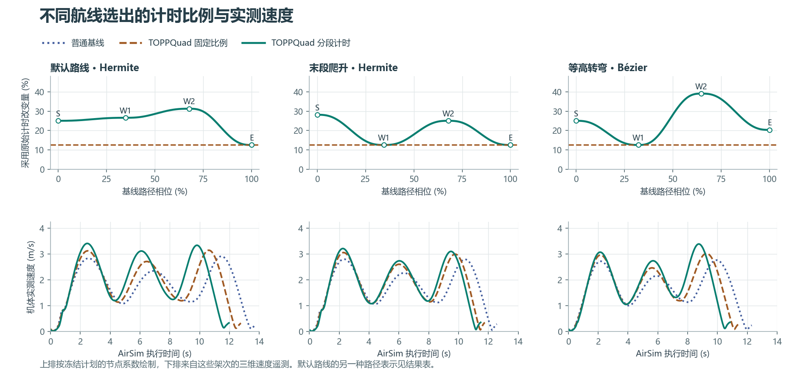

# 连续过点的分段计时实测

2026-11-22 在 AirSim Blocks 的同一 GenericQuadX 配置上完成 12 架次，12 次通过全部控制判据并确认降落、电机上锁并归还 API 控制权。每条路线内条件指纹相同，飞行参考在到达准备点后生成。每个“路线 × 表示 × 方法”组合实测一次。默认路线的 Hermite 与 Bézier 描述同一几何路径。数据取自 AirSim，Codex 完成复算、制表和绘图。[逐架指标](flights.csv) · [遥测及完整候选记录](telemetry.zip)

## 从参考启动到终点达标的实际用时

| 路线 | 表示 | 普通基线 (s) | 固定比例 TOPPQuad (s) | 分段 TOPPQuad (s) | 分段比固定节省 (s) | 分段峰值误差 (m) | 分段实测峰速 (m/s) |
|---|---|---:|---:|---:|---:|---:|---:|
| 默认路线 | Hermite | 13.800 | 12.777 | 11.964 | 0.813 | 0.2371 | 3.412 |
| 默认路线 | Bézier | 13.794 | 12.789 | 11.976 | 0.813 | 0.2380 | 3.416 |
| 末段爬升 | Hermite | 12.570 | 11.784 | 11.493 | 0.291 | 0.2357 | 3.214 |
| 等高转弯 | Bézier | 12.309 | 11.460 | 10.851 | 0.609 | 0.2391 | 3.390 |

各 TOPPQuad 组共用名义指令预留、0.13 m 预测误差裕量、剩余制动和采样推力预检。此前固定 31.25% 的比例扫描在另一种预检口径下执行，默认路线当时的实测用时为 11.730–11.742 s。本表的配对差只适用于本次同条件对照。

## 规划选出的系数和飞行过点速度

| 路线 | 表示 | 起点 → W1 → W2 → 终点 | 通过预检 / 已评价 | W1 / W2 参考速度 (m/s) | W1 / W2 实测速度 (m/s) | 准备点规划墙钟 (s) |
|---|---|---|---:|---:|---:|---:|
| 默认路线 | Hermite | 25% → 26.5625% → 31.25% → 12.5% | 28/47 | 1.426 / 1.380 | 1.196 / 1.334 | 26.44 |
| 默认路线 | Bézier | 25% → 26.5625% → 31.25% → 12.5% | 28/47 | 1.426 / 1.380 | 1.195 / 1.335 | 20.82 |
| 末段爬升 | Hermite | 28.125% → 12.5% → 25% → 12.5% | 26/48 | 1.274 / 1.336 | 1.080 / 1.247 | 27.44 |
| 等高转弯 | Bézier | 25% → 12.5% → 39.0625% → 20.3125% | 28/50 | 1.298 / 1.459 | 1.066 / 1.333 | 30.74 |

分段计时的完整规划墙钟为 20.82–30.74 s，固定比例对照为 10.75–23.12 s。每架次连续 TOPPQuad 进行一次原始刚体求解，候选评价全部在模型中完成。分段结果取已评估可行候选的最短参考用时。规划墙钟与实际飞行用时分别计量。



## 路线和判据

共同准备点为 (0, 0, 5) m。坐标依次为北、东、高度，各点按表中顺序执行。

| 路线 | W1 → W2 → E (m) | 原始批次目录 |
|---|---|---|
| 默认路线 | (8, 0, 5) → (12, 6, 7) → (6, 10, 6) | `verification_20261122_094844_749612` |
| 末段爬升 | (7, 1, 5) → (10, 7, 6) → (5, 11, 7) | `verification_20261122_095402_293210` |
| 等高转弯 | (6, -2, 5) → (10, -7, 5) → (17, -8, 5) | `verification_20261122_095644_426163` |

验收采用实际状态时间戳。全程同步位置误差峰值 ≤ 0.30 m，中间点按计划时刻插值后距离 ≤ 0.30 m 且实际速度 ≥ 0.50 m/s，参考结束时位置误差 ≤ 0.25 m 且实际速度 ≤ 0.50 m/s。速度指令上限 6 m/s，指令变化率上限 6 m/s²。分段组另复核到达准备点后提交一次原始求解、选中候选为可行集合内最短参考以及规划证据哈希。[计算代码](../../python/flight_comparison.py)

## 独立复算

从仓库根目录在 PowerShell 执行以下命令可生成三份本地对照页。复算读取压缩包内的原始状态、计划、落地回执及验证记录，无需启动仿真。压缩包中每份原始文件的 SHA-256 位于 provenance.json。

```powershell
$outputDir = 'reports/segment_retiming_audit_local'
Expand-Archive -LiteralPath 'reports/segment_retiming_20261122/telemetry.zip' -DestinationPath $outputDir
foreach ($route in 'default','climb','level') {
    .\.venv\python.exe python/flight_comparison.py (Join-Path $outputDir $route)
}
```

实测实现提交为 `67c5d2fc0c0e2599e411cd4a903c9f331c8fa28d`。遥测压缩包的 SHA-256 为 `7177a439713f16ad8c7438880d099fc1abd97bc49c8c98f3825bfc01b93f1105`。
